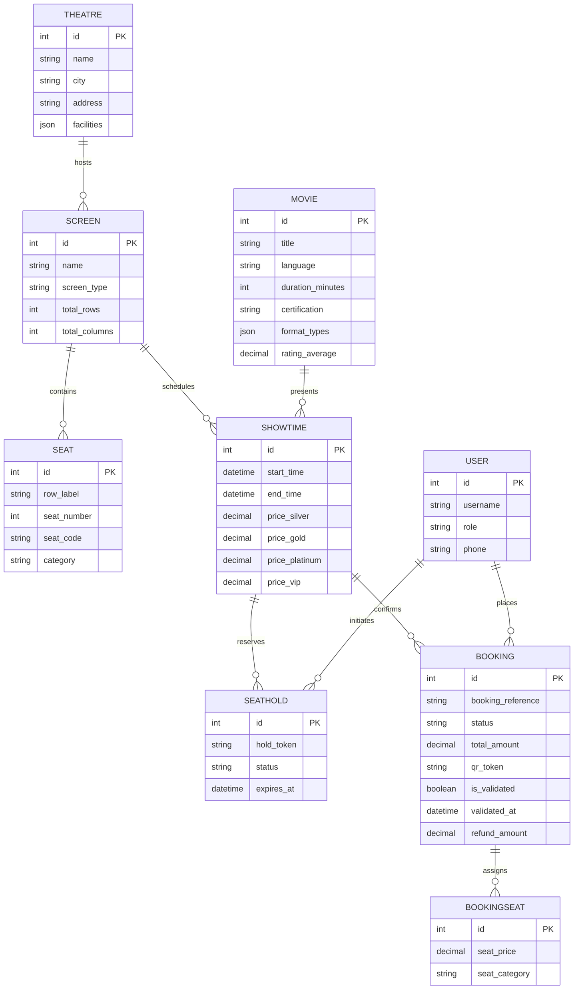

# CinemaBox — Cinema Hall Ticket Booking System

[](https://www.python.org/)
[](https://www.djangoproject.com/)
[](https://www.mongodb.com/)
[](https://render.com/)
[]()

> **Full-Stack Web Development Advanced Assessment Project**  
> Candidate Project: **Cinema Hall Ticket Booking System** ("BookMyShow" style application)  
> Assigned by: **ALGIONS AI LABS PRIVATE LIMITED**

---

## 📌 Executive Summary & Architecture

**CinemaBox** is a high-concurrency, responsive full-stack cinema ticket reservation platform modeled after industry leaders like BookMyShow. It features temporary seat locks with TTL expiry, duplicate booking prevention via ACID database transactions, cryptographic QR code ticket issuance, operational gate entry scanning, and live occupancy reconciliation.

### Polyglot Persistence Architecture (Relational + NoSQL)

```
                            ┌─────────────────────────────────────────┐
                            │               CinemaBox UI              │
                            │   (Tailwind / Responsive BookMyShow UI) │
                            └────────────────────┬────────────────────┘
                                                 │
                                                 ▼
                            ┌─────────────────────────────────────────┐
                            │       Django 5.1 Application Layer      │
                            │ (Auth RBAC / REST API / Swagger Docs)   │
                            └─────────┬─────────────────────┬─────────┘
                                      │                     │
                    ACID Core Entities│                     │High-Throughput Documents
                                      ▼                     ▼
        ┌───────────────────────────────────┐    ┌───────────────────────────────────┐
        │  Relational Database (PostgreSQL) │    │      NoSQL Document Database      │
        │      (SQLite for Local/Render)    │    │   (MongoDB Atlas / Embedded Store)│
        ├───────────────────────────────────┤    ├───────────────────────────────────┤
        │ • User (RBAC: Customer/Staff/Admin│    │ • ticket_scans (Gate entry logs)  │
        │ • Theatre, Screen, Seat (Grid)    │    │ • audit_events (Material actions) │
        │ • Movie, Genre, Showtime          │    │ • movie_reviews (Dynamic ratings) │
        │ • SeatHold (Locks & TTL Expiry)   │    │ • seat_matrix_cache (Inventory)   │
        │ • Booking, BookingSeat            │    └───────────────────────────────────┘
        └───────────────────────────────────┘
```

1. **Relational ACID Layer (PostgreSQL / SQLite)**:
   - Enforces transactional integrity, foreign key relations, and strict concurrency safety (`select_for_update`) to prevent any double-booking.
2. **NoSQL Document Database Layer (MongoDB via PyMongo + Resilient Embedded Fallback)**:
   - **`ticket_scans`**: High-throughput append-only document collection for gate security audits.
   - **`audit_events`**: Immutable event stream logging every seat hold, conversion, cancellation, and refund.
   - **`movie_reviews`**: Dynamic schema for customer reviews, sentiment tags, and star ratings.
   - **`seat_matrix_cache`**: High-speed document snapshot of screen layouts and live seat states.

---

## 🚀 Quick Local Setup Guide (with `env`)

### 1. Prerequisites
- Python 3.10+ (tested on Python 3.13)
- Git

### 2. Clone and Setup Environment
```bash
# Navigate to the project root
cd ALGIONS

# Activate the virtual environment
# Windows:
.\env\Scripts\activate
# Linux/macOS:
source env/bin/activate

# Install dependencies
pip install -r requirements.txt
```

### 3. Initialize Database & Seed Data
```bash
# Run migrations
python manage.py migrate

# Seed sample movies, theatres, screens, seats, showtimes, and reviews
python manage.py seed_data

# Collect static files
python manage.py collectstatic --noinput
```

### 4. Run Development Server
```bash
python manage.py runserver
```
Visit the application in your browser at: **`http://127.0.0.1:8000/`**

---

## 🔑 Pre-Configured Demo Credentials

For quick evaluation, convenient **1-click demo login buttons** are available at the top of every page. You can also sign in manually:

| Role | Username | Password | Access Capabilities |
|------|----------|----------|---------------------|
| **Cinema Admin** | `admin` | `admin123` | Occupancy reports, revenue analytics, audit trail, Django admin (`/admin/`) |
| **Gate Staff** | `staff1` | `staff123` | Operational gate scanner (`/bookings/staff/gate-scanner/`), QR validation |
| **Customer** | `customer1` | `customer123` | Browse, interactive seat picker, hold seats, checkout, booking history, cancel |
| **Customer 2** | `priya_sharma` | `customer123` | Secondary customer for testing concurrency and conflict prevention |

---

## 🌐 Deploying to Render.com (Zero-Cost Hosting)

CinemaBox is 100% pre-configured for **Render Web Service** deployment with Gunicorn and Whitenoise:

1. **Push your code to GitHub / GitLab**.
2. **Create New Web Service on Render**:
   - Repository: Select your repository.
   - Environment: `Python 3`
   - Build Command: `./build.sh`
   - Start Command: `gunicorn cinemabox.wsgi:application`
3. **Environment Variables on Render**:
   - `PYTHON_VERSION`: `3.13.2`
   - `DJANGO_SECRET_KEY`: `<generate or set random string>`
   - `DJANGO_DEBUG`: `False`
   - `ALLOWED_HOSTS`: `.onrender.com`
   - *(Optional)* `MONGODB_URI`: `mongodb+srv://<user>:<password>@cluster0.mongodb.net/?retryWrites=true&w=majority` (Connects directly to your free MongoDB Atlas database; if omitted, automatically uses the embedded resilient document store).

---

## 🧪 Automated Test Suite & Acceptance Verification

Run the test suite covering all 5 explicit assessment criteria:
```bash
python manage.py test tests
```

### Acceptance Criteria Verification Table

| # | Assessment Acceptance Criterion | Test Method | Status | Verification Evidence |
|---|----------------------------------|-------------|:------:|-----------------------|
| 1 | **Available seat can be held and booked** | `test_01_available_seat_can_be_held_and_booked` | **PASS** | Creates `SeatHold`, locks seat with token, converts to confirmed `Booking`, verifies unique `BMS-...` reference and QR token. |
| 2 | **Same seat cannot be confirmed to 2 users** | `test_02_double_booking_concurrency_prevention` | **PASS** | Tests concurrent hold on identical seat; User B receives `SeatUnavailableError` (HTTP 409 Conflict). |
| 3 | **Expired holds release seat; confirmed stays booked** | `test_03_expired_holds_release_seat_and_confirmed_remain_booked` | **PASS** | Backdated holds transition to `EXPIRED`, seat status resets to `AVAILABLE`, while confirmed seat remains `BOOKED`. |
| 4 | **Ticket QR validated once in simulated entry flow** | `test_04_single_use_ticket_qr_validation` | **PASS** | 1st scan approves entry (`VALID_ENTRY`); 2nd scan throws `TicketAlreadyUsedError` (`ALREADY_USED`) and logs to NoSQL. |
| 5 | **Occupancy report matches bookings & cancellations** | `test_05_occupancy_report_matches_bookings_and_cancellations` | **PASS** | Mathematical proof: `Capacity = Confirmed + Active Holds + Available`. Confirmed bookings increase occupancy; cancellations decrement confirmed count and calculate refund. |
| 6 | **Negative & RBAC Security Cases** | `test_06_cannot_cancel_past_show`, `test_07_unauthorized_user_cannot_cancel_others_booking` | **PASS** | Confirms past show cancellation rejection and customer privilege isolation. |

---

## 📊 Database Schema & ER Diagram



---

## 📡 REST API & OpenAPI Documentation

Interactive Swagger 3.0 UI is embedded at:
- **Swagger UI**: `/api/docs/`
- **Redoc**: `/api/redoc/`
- **OpenAPI 3.0 Schema**: `/api/schema/`

### Key API Endpoints
- `GET /api/movies/`: Search & filter movies (by genre, language, city).
- `GET /api/showtimes/{id}/seats/`: Real-time visual seat map (available, held, booked).
- `POST /api/bookings/hold/`: Acquire temporary seat hold with TTL countdown.
- `POST /api/bookings/confirm/`: Confirm reservation and issue ticket with QR.
- `POST /api/bookings/{ref}/cancel/`: Cancel reservation with simulated refund.
- `POST /api/staff/validate-ticket/`: Gate scanner ticket validation (staff only).
- `GET /api/admin/reports/occupancy/`: Occupancy and sales reconciliation report.
- `GET /api/nosql/status/`: NoSQL database health and collection diagnostics.

---

## ⚖️ Known Limitations & Assumptions
1. **Payment Simulation**: Real payment processing (Razorpay/Stripe) is simulated in accordance with assessment rules forbidding live financial credentials.
2. **Hold Expiry Worker**: Temporary holds are lazily flushed during seat matrix queries and booking calls; in an enterprise production cluster, Celery beat or Redis keyspace notifications can be added for sub-second TTL eviction.
3. **NoSQL Dual-Mode**: PyMongo connects to MongoDB Atlas when `MONGODB_URI` is supplied, falling back to a thread-safe local JSON document store for zero-friction evaluation.

